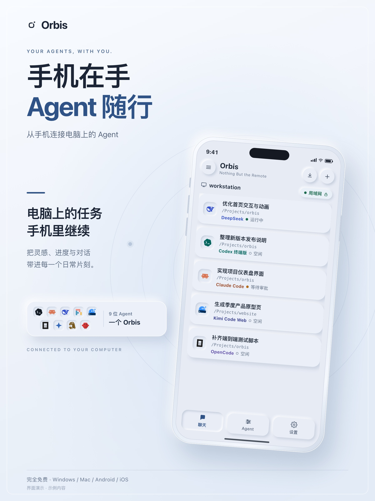
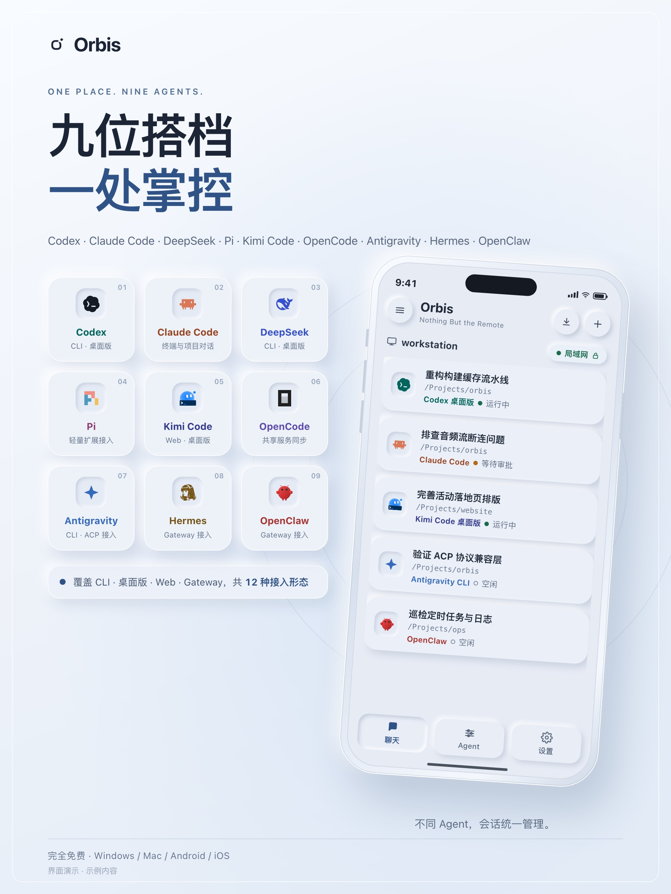
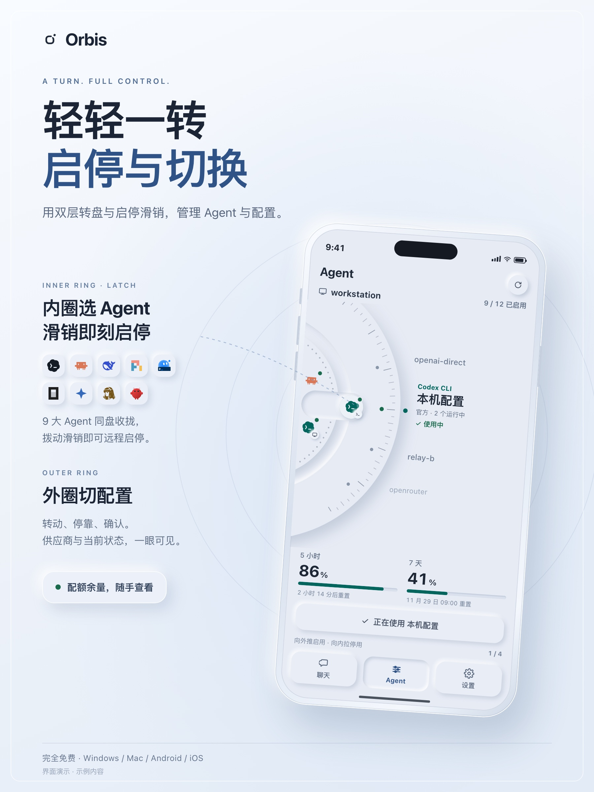
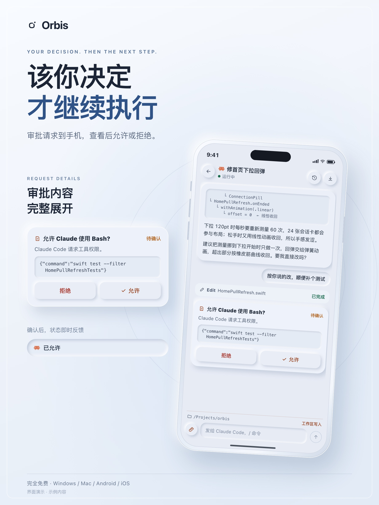
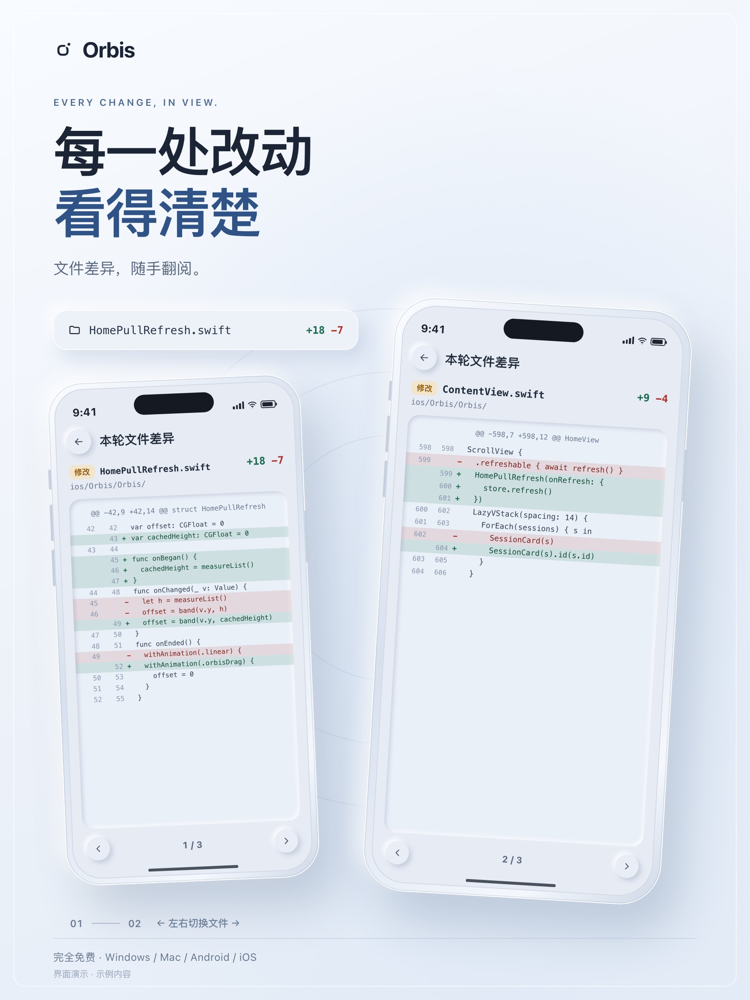
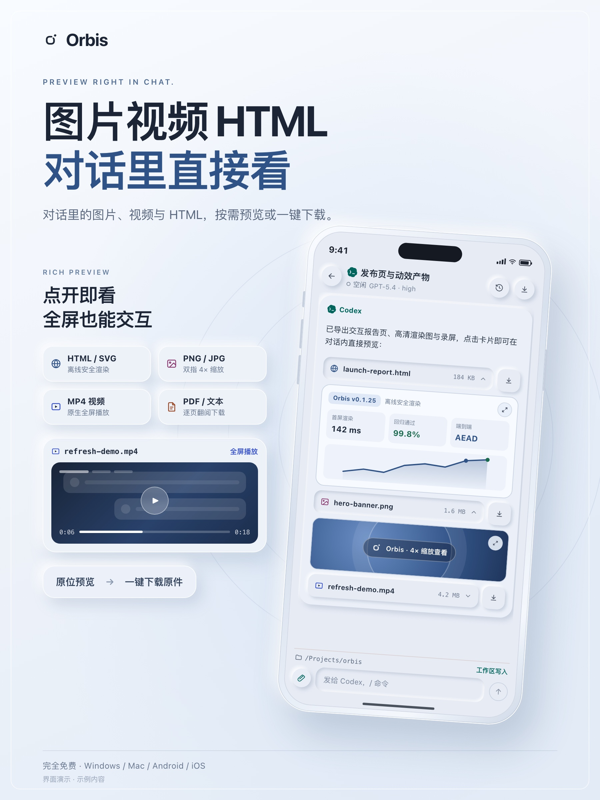
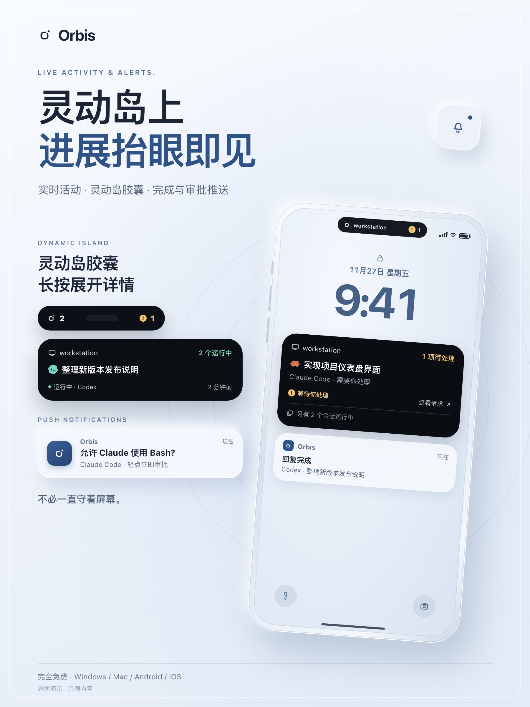
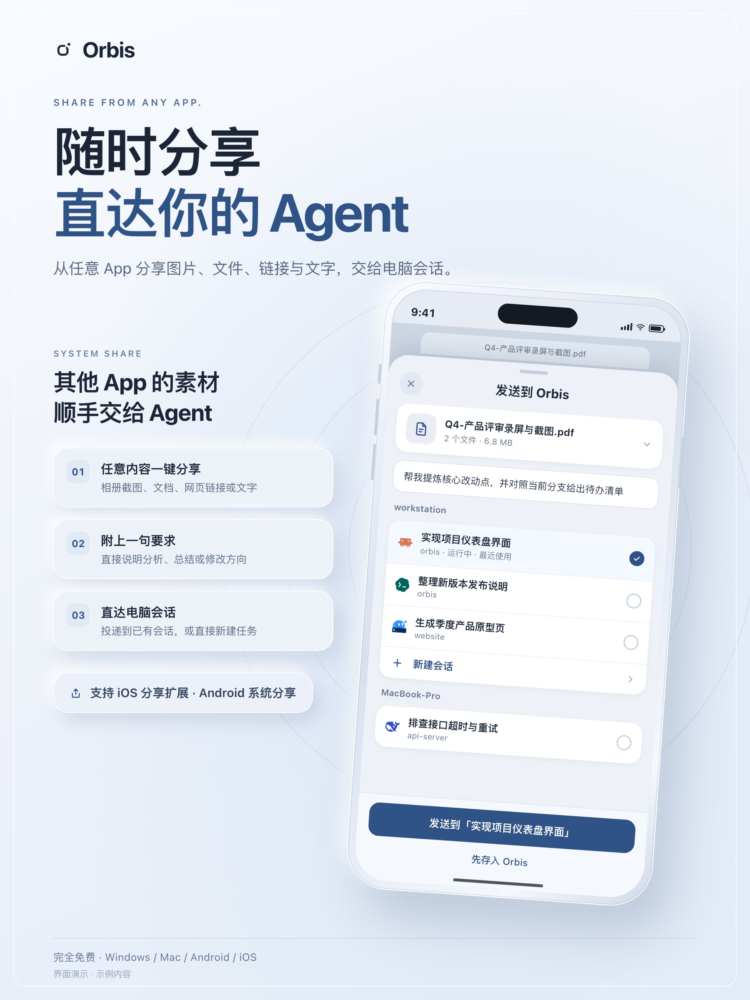
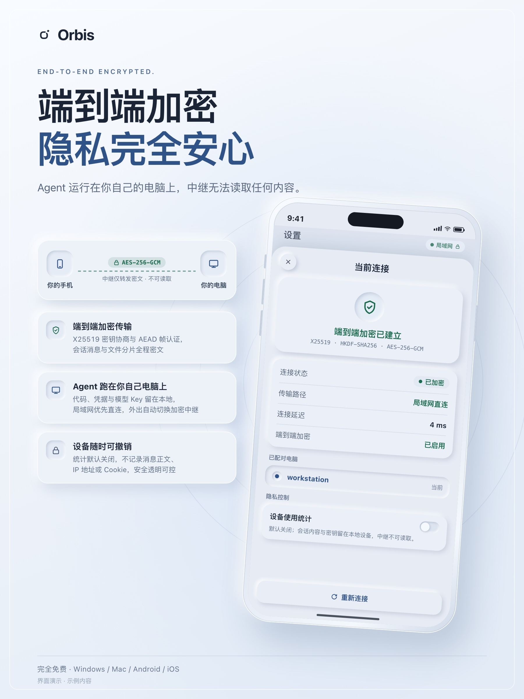

  

<h1 align="center">Orbis</h1>

<strong>Nothing But the Remote.</strong> Maybe all you need is a remote.

<a href="README.md">简体中文</a> · <strong>English</strong>

  <a href="https://orbising.com/">Website</a> ·
  <a href="https://orbising.com/#experience">Interactive demo</a> ·
  <a href="https://orbising.com/#download">Download</a> ·
  <a href="https://github.com/WGooold/Orbis/releases">Releases</a> ·
  <a href="https://github.com/WGooold/Orbis/issues">Feedback</a>

Your desktop agents, continued on your phone.

Run **Orbis Host** on your computer, install **Orbis App** on your phone, and scan to connect.

## On your phone

| Feature | |
| --- | --- |
| Live chat | Send tasks, follow progress, add to or stop a turn. |
| File review | Every change from the turn, one by one. |
| File downloads | Files from your computer, saved to your phone. |
| Sessions | Find any session by computer and project, and pick it up. |
| New sessions | Pick an agent and a folder, and start. |
| Usage | Limits and reset times. |
| QR pairing | Scan to connect. Pair as many computers as you like. |

[Try the interactive demo](https://orbising.com/#experience)

## Screens

<table>
  <tr>
    <td align="center" width="33%"></td>
    <td align="center" width="33%"></td>
    <td align="center" width="33%"></td>
  </tr>
  <tr>
    <td align="center" width="33%"></td>
    <td align="center" width="33%"></td>
    <td align="center" width="33%"></td>
  </tr>
  <tr>
    <td align="center" width="33%"></td>
    <td align="center" width="33%"></td>
    <td align="center" width="33%"></td>
  </tr>
</table>

## Supported agents

**Codex (CLI / Desktop) · Claude Code · DeepSeek (CLI / Desktop) · Pi · Kimi Code (Web / Desktop) · OpenCode · Antigravity CLI · Hermes Agent · OpenClaw**

Set up the agent on your computer and complete any required sign-in or model configuration before connecting. Available actions depend on the agent and are shown in the app.

See the [website](https://orbising.com/) for upcoming integrations.

## Download

| Device | Platform | Installation |
| --- | --- | --- |
| Computer | Windows 10 / 11 (x64) | [Get Orbis Host](https://orbising.com/#download) as an EXE installer or a portable ZIP. |
| Computer | macOS (Apple Silicon / Intel) | [Get Orbis Host](https://orbising.com/#download) as a DMG for your chip. |
| Phone | Android | [Download the Orbis App APK](https://orbising.com/downloads/orbis.apk). |
| Phone | iOS | [Join the iOS TestFlight beta](https://testflight.apple.com/join/9zGP1NZX) and install the Orbis App through TestFlight. |

Orbis is currently in preview. Check the website for current downloads and availability, or visit [GitHub Releases](https://github.com/WGooold/Orbis/releases) for earlier versions.

## Get started

1. **Install Orbis Host on your computer.** On Windows, use the installer or extract the entire ZIP and run `OrbisHost.exe`. On macOS, open the DMG and drag Orbis Host into Applications.
2. **Set up your agent.** Open Host, follow the activation prompts, and use the Agent page to check that your agent is ready. Complete sign-in or model configuration as needed. For DeepSeek, enable DeepSeek Harness in Settings.
3. **Install Orbis App on your phone.** Start Host on your computer, choose “Add phone,” and scan the pairing code with the mobile app.
4. **Continue your work.** Open an existing session on your phone, or choose an agent and a project folder to start a new one.

Keep your computer awake and connected, with Orbis Host running. Orbis prefers a direct connection when both devices are on the same local network and can use a relay when you are away.

## Connection and privacy

Your agents run on your own computer. Conversations and file transfers between your phone and computer are end-to-end encrypted, so the relay cannot read their contents. Manage paired devices on your computer and revoke access for devices you no longer use.

The Relay counts homepage visits, download categories and bytes, registration and pairing-code events, and service metrics such as CPU, memory, connections, and event-loop delay. It does not record IP addresses, cookies, email addresses, user agents, message contents, or URL query parameters. Per-device message traffic, connection duration, and bandwidth details are off by default. Enable them in **App Settings → Privacy → Device usage sharing**. Turning this off deletes that device's detailed history; aggregate service metrics remain. See [`packages/relay/TELEMETRY.md`](packages/relay/TELEMETRY.md).

## Join the Orbis community

Share your experience, suggest improvements, or discuss a problem with other users. Scan the code below in WeChat to join the **Orbis community group**.

  

The QR code is valid for **7 days after generation**; reopen the QR-code page in WeChat to refresh it. If it has expired, request a fresh code through [GitHub Issues](https://github.com/WGooold/Orbis/issues). When reporting a problem, include your device OS, Orbis version, and steps to reproduce it.

## Open source and license

Original Orbis code is available under the [MIT License](LICENSE). Third-party components and icons retain their own licenses; see [Third-party notices](THIRD-PARTY-NOTICES.md). Contributions through [Issues](https://github.com/WGooold/Orbis/issues) and [Pull Requests](https://github.com/WGooold/Orbis/pulls) are welcome.
