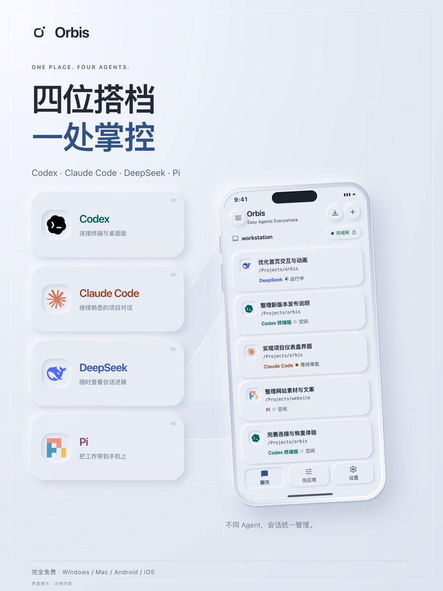
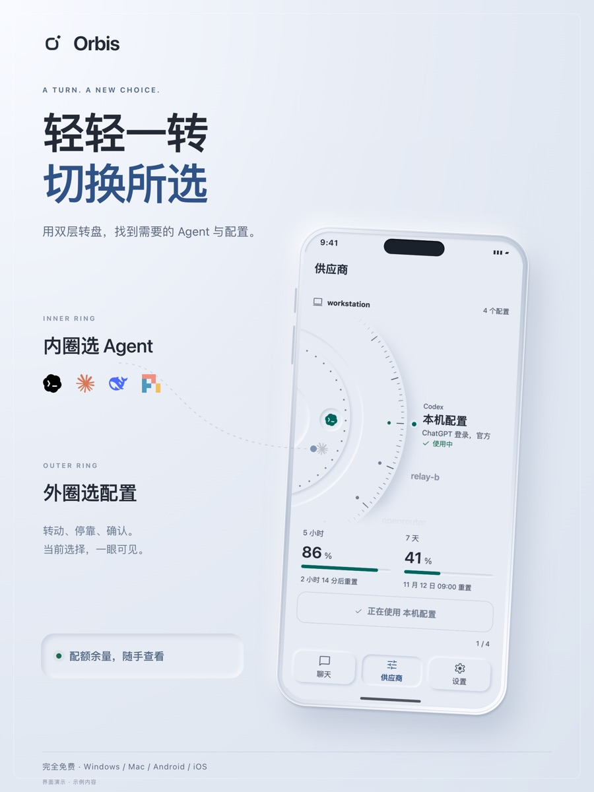
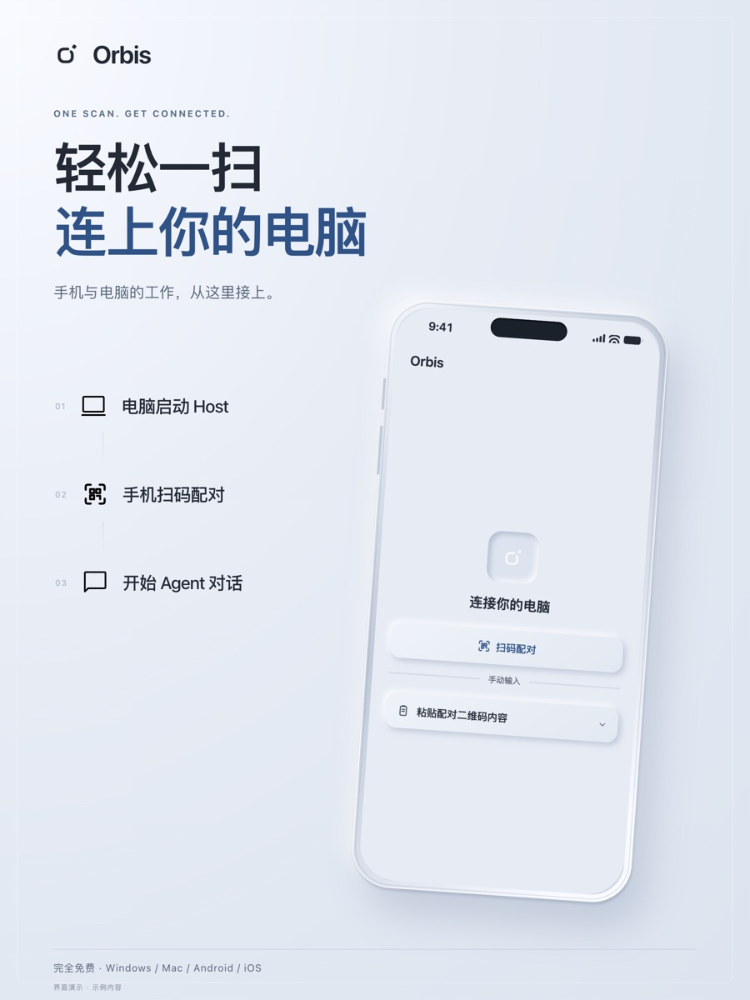
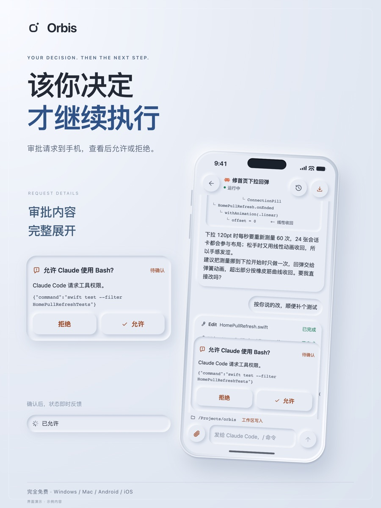
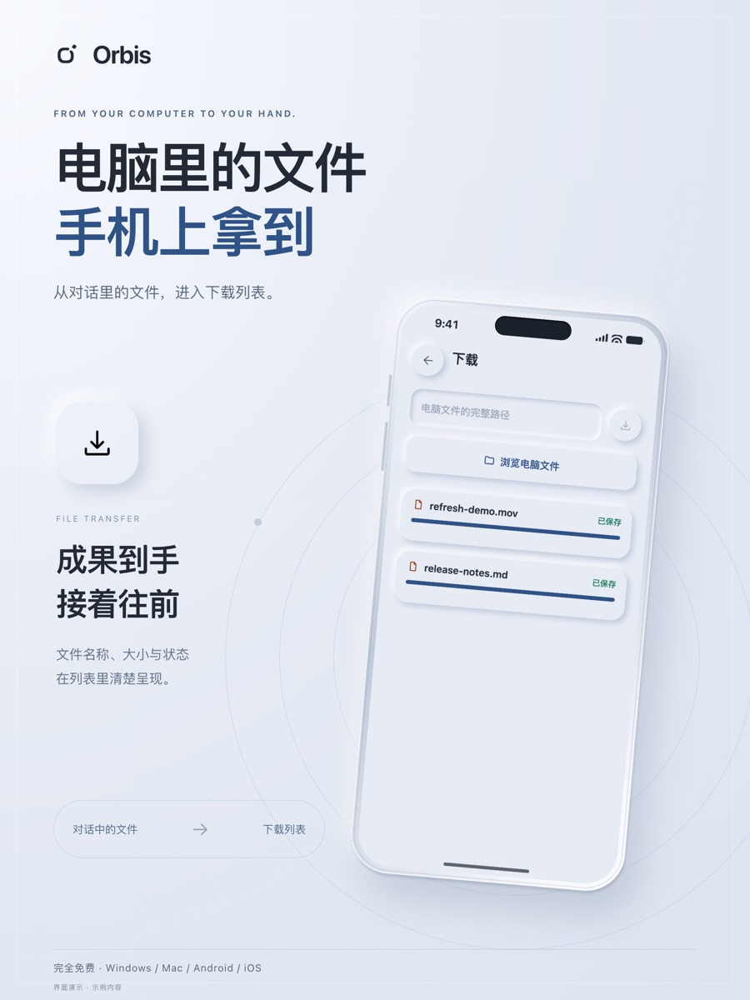
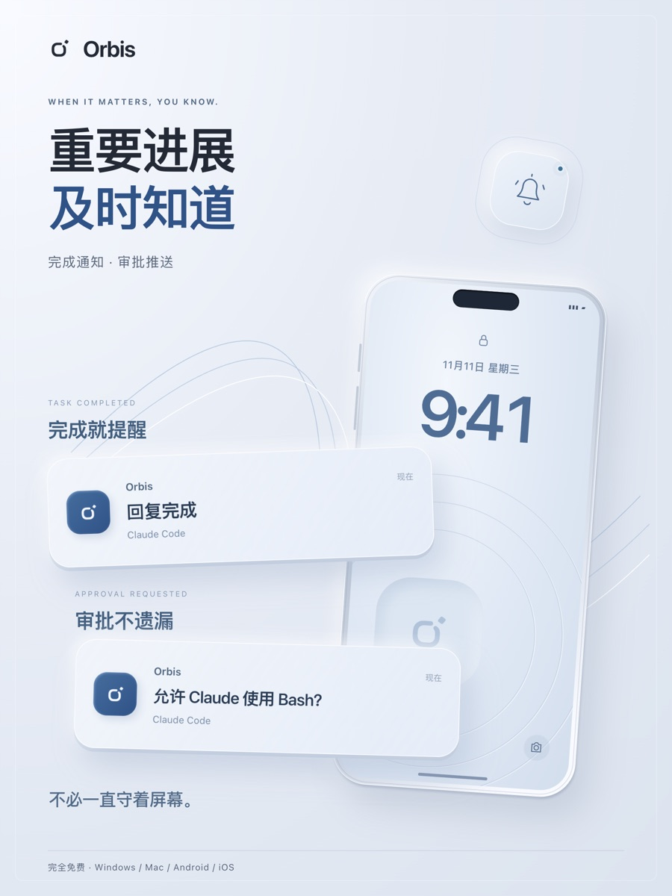
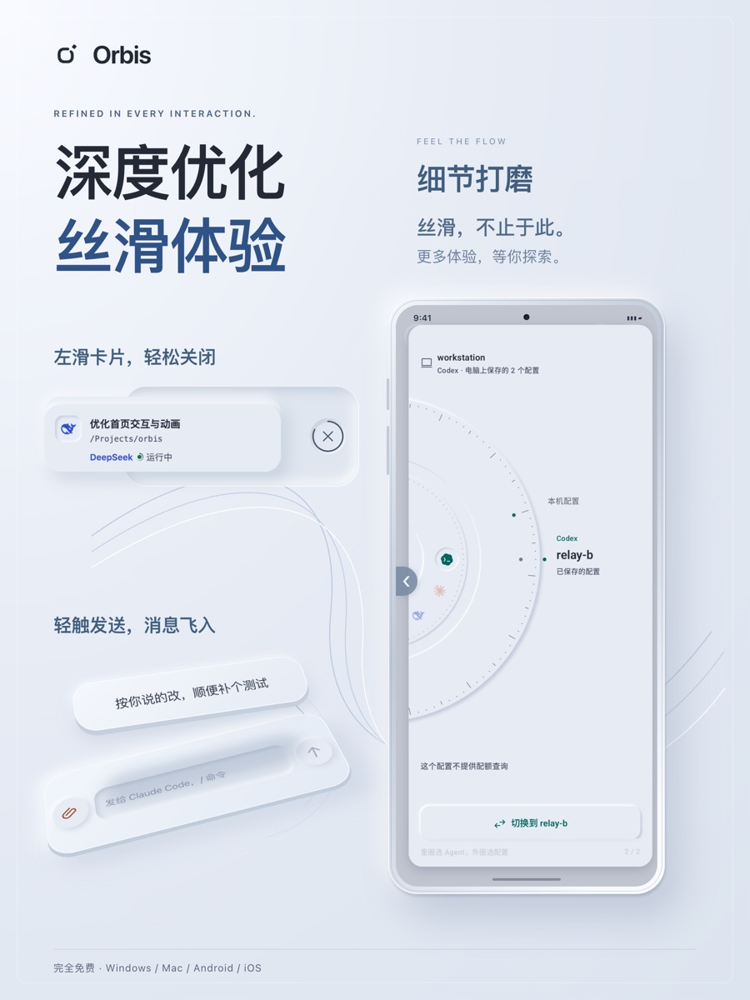

  

<h1 align="center">Orbis</h1>

<strong>Easy Agents Everywhere.</strong> Zero desktop intrusion. The smoothest mobile remote behind all your agents.

<a href="README.md">简体中文</a> · <strong>English</strong>

  <a href="https://orbising.com/">Website</a> ·
  <a href="https://orbising.com/#experience">Interactive demo</a> ·
  <a href="https://orbising.com/#download">Download</a> ·
  <a href="https://github.com/WGooold/Orbis/releases">Releases</a> ·
  <a href="https://github.com/WGooold/Orbis/issues">Feedback</a>

Orbis never merges or gets in the way of your native desktop agents. Keep using Claude Code, Codex, DeepSeek, or Pi as usual—Orbis quietly backs them up, focused purely on the smoothest mobile remote control.

Run **Orbis Host** on your computer, install **Orbis App** on your phone, scan once to continue chats, follow progress, review diffs, and download files.

## What you can do from your phone

| Feature | What it lets you do |
| --- | --- |
| Live chat | Send tasks, follow responses and tool activity, add instructions, or stop the current task. |
| File review | See which files changed during a turn and inspect the differences. |
| File downloads | Browse files on your computer and download the results to your phone. |
| Session management | Find conversations by computer and project folder, switch tasks, and resume earlier sessions. |
| New sessions | Choose an agent and a project folder on your computer to start a new task. |
| Subscription usage | Check usage limits and reset times for supported accounts. |
| QR pairing | Scan a code on your computer to connect it. You can pair more than one computer. |

[Try the interactive demo on the website](https://orbising.com/#experience) to explore chat, file review, and session switching.

## Screens

<table>
  <tr>
    <td align="center" width="33%"></td>
    <td align="center" width="33%"></td>
    <td align="center" width="33%"></td>
  </tr>
  <tr>
    <td align="center" width="33%"></td>
    <td align="center" width="33%"></td>
    <td align="center" width="33%"></td>
  </tr>
  <tr>
    <td align="center" width="33%"></td>
    <td align="center" width="33%"></td>
    <td align="center" width="33%"></td>
  </tr>
</table>

## Supported agents

**Claude Code · Codex · Codex Desktop · Pi · DeepSeek (via DeepSeek Harness)**

Set up the agent on your computer and complete any required sign-in or model configuration before connecting. Available actions depend on the agent and are shown in the app.

See the [website](https://orbising.com/) for upcoming integrations.

## Download

| Device | Platform | Installation |
| --- | --- | --- |
| Computer | Windows 10 / 11 (x64) | [Get Orbis Host](https://orbising.com/#download) as an EXE installer or a portable ZIP. |
| Computer | macOS (Apple Silicon / Intel) | [Get Orbis Host](https://orbising.com/#download) as a DMG for your chip. |
| Phone | Android | [Download the Orbis App APK](https://orbising.com/downloads/orbis.apk). |
| Phone | iOS | [Join the iOS TestFlight beta](https://testflight.apple.com/join/9zGP1NZX) and install the Orbis App through TestFlight. |

Orbis is currently in preview. Check the website for current downloads and availability, or visit [GitHub Releases](https://github.com/WGooold/Orbis/releases) for earlier versions.

## Get started

1. **Install Orbis Host on your computer.** On Windows, use the installer or extract the entire ZIP and run `OrbisHost.exe`. On macOS, open the DMG and drag Orbis Host into Applications.
2. **Set up your agent.** Open Host, follow the activation prompts, and use the Agent page to check that your agent is ready. Complete sign-in or model configuration as needed. For DeepSeek, enable DeepSeek Harness in Settings.
3. **Install Orbis App on your phone.** Start Host on your computer, choose “Add phone,” and scan the pairing code with the mobile app.
4. **Continue your work.** Open an existing session on your phone, or choose an agent and a project folder to start a new one.

Keep your computer awake and connected, with Orbis Host running. Orbis prefers a direct connection when both devices are on the same local network and can use a relay when you are away.

## Connection and privacy

Your agents run on your own computer. Conversations and file transfers between your phone and computer are end-to-end encrypted, so the relay cannot read their contents. Manage paired devices on your computer and revoke access for devices you no longer use.

## Join the Orbis community

Share your experience, suggest improvements, or discuss a problem with other users. Scan the code below in WeChat to join the **Orbis community group**.

  

The QR code is marked as valid **before November 25, 2026**. If it has expired, request a fresh code through [GitHub Issues](https://github.com/WGooold/Orbis/issues). When reporting a problem, include your device OS, Orbis version, and steps to reproduce it.

## Open source and license

Original Orbis code is available under the [MIT License](LICENSE). Third-party components and icons retain their own licenses; see [Third-party notices](THIRD-PARTY-NOTICES.md). Contributions through [Issues](https://github.com/WGooold/Orbis/issues) and [Pull Requests](https://github.com/WGooold/Orbis/pulls) are welcome.
