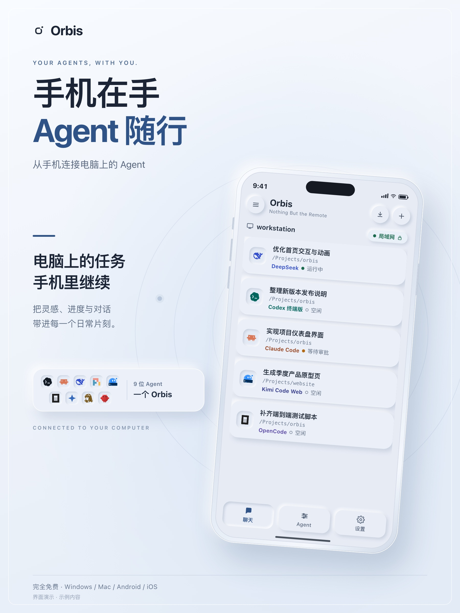
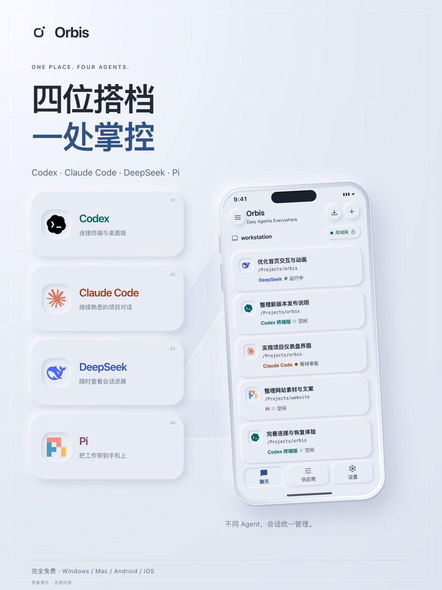
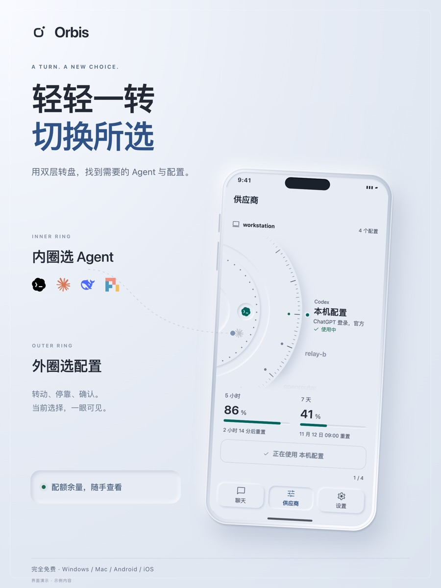
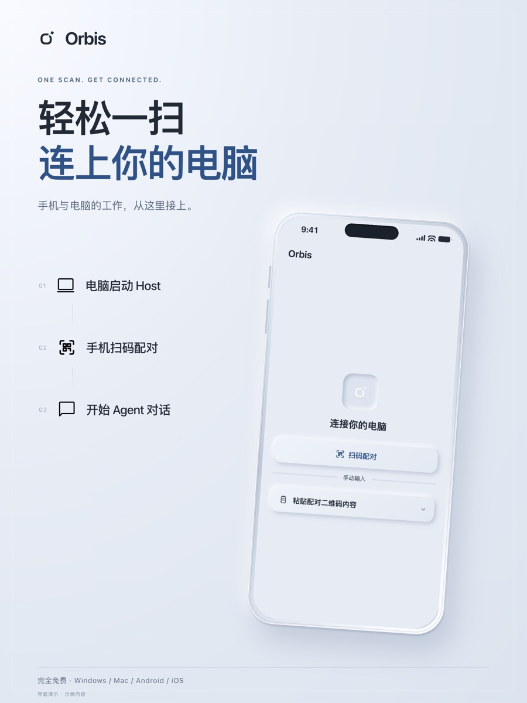
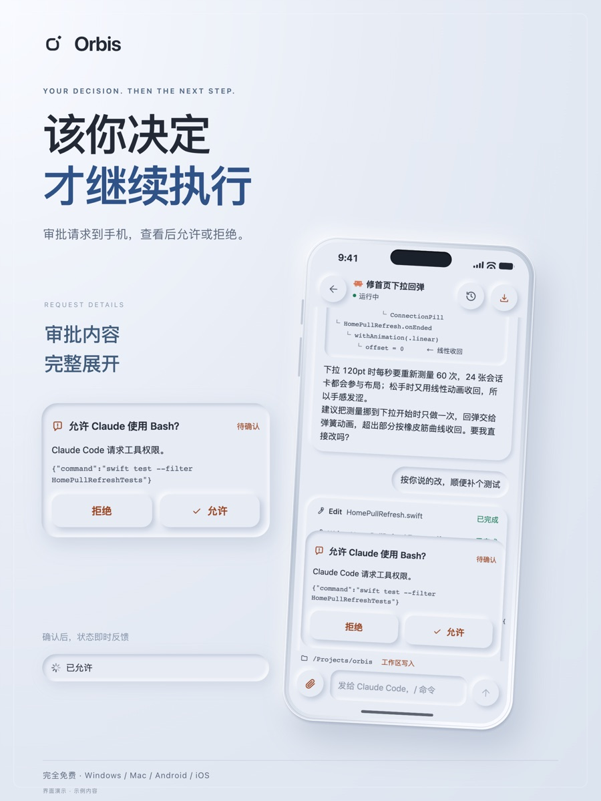
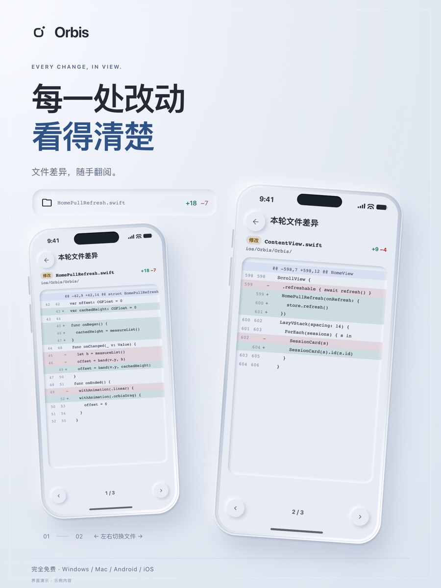
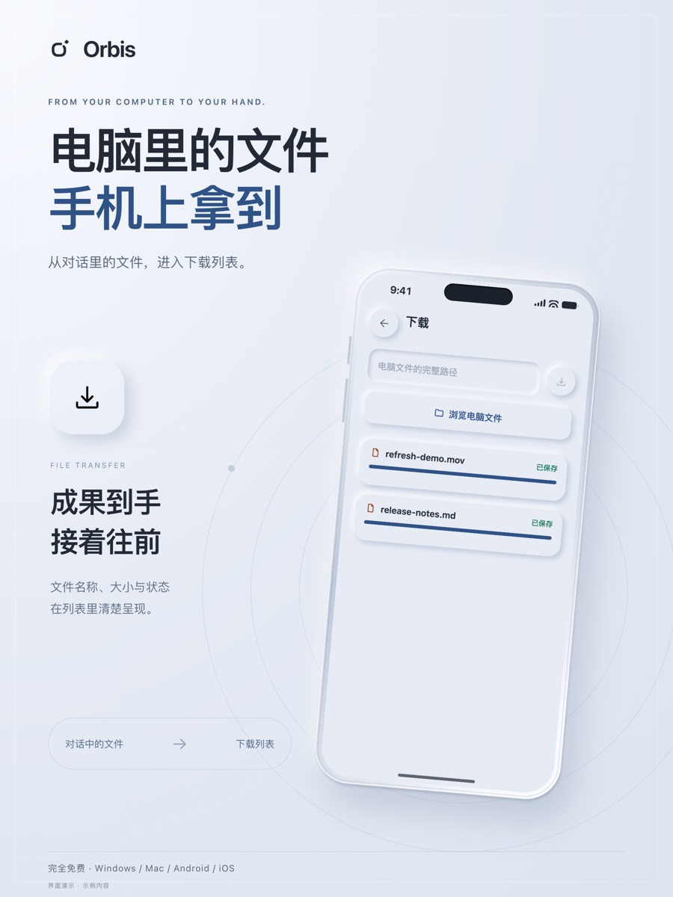
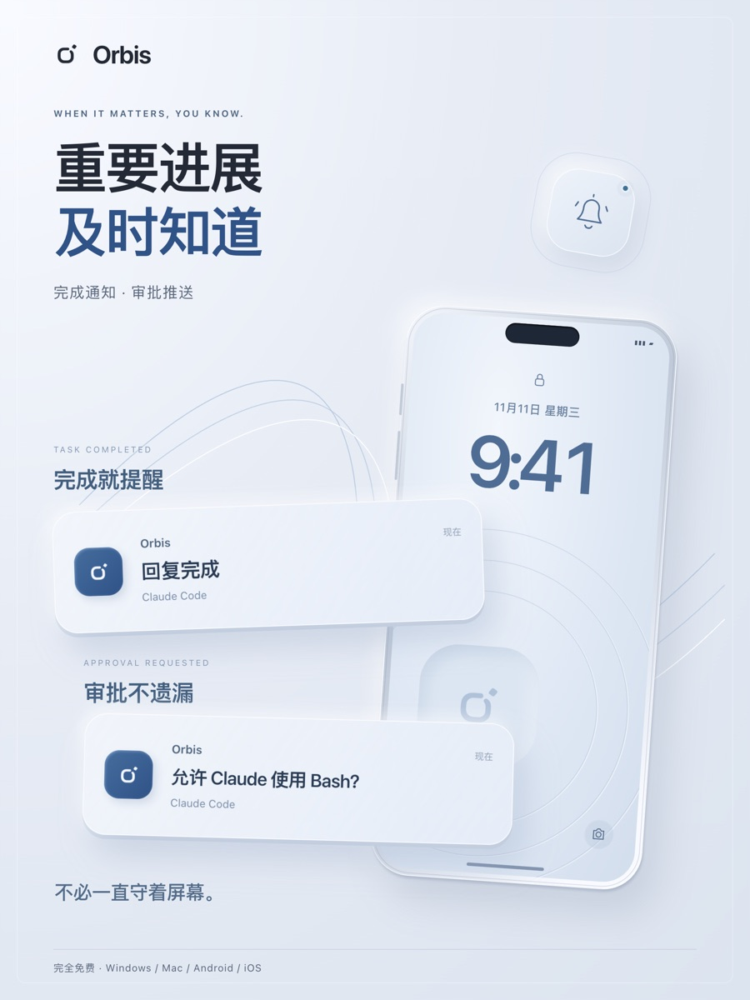
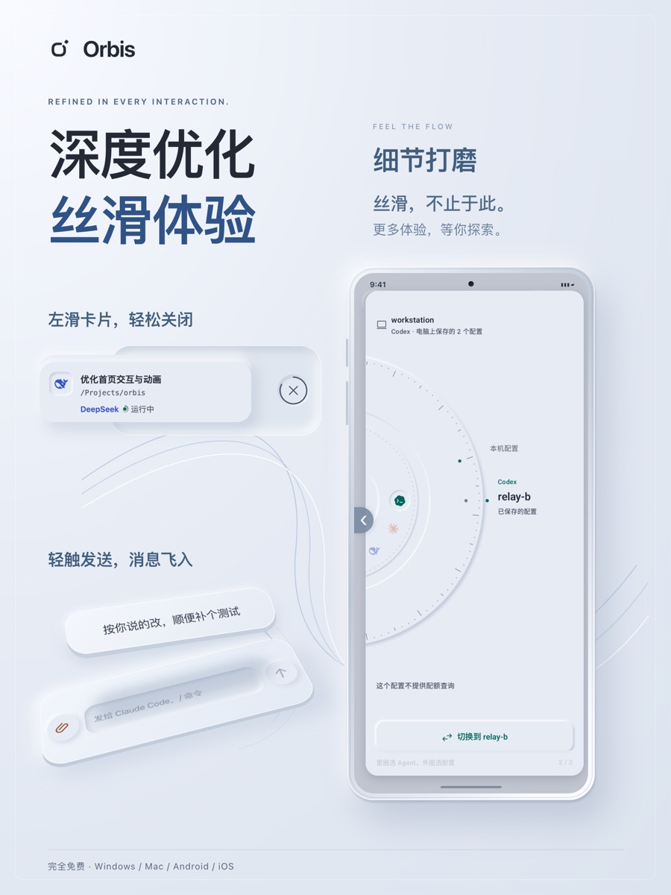

  

<h1 align="center">Orbis</h1>

<strong>Nothing But the Remote.</strong> 其实，你只缺一个远控。

<strong>简体中文</strong> · <a href="README.en.md">English</a>

  <a href="https://orbising.com/">官网</a> ·
  <a href="https://orbising.com/#experience">交互演示</a> ·
  <a href="https://orbising.com/#download">下载安装</a> ·
  <a href="https://github.com/WGooold/Orbis/releases">版本更新</a> ·
  <a href="https://github.com/WGooold/Orbis/issues">问题反馈</a>

电脑上的 Agent，在手机上继续。

电脑运行 **Orbis Host**，手机安装 **Orbis App**，扫码即可连接。

## 在手机上

| 功能 | |
| --- | --- |
| 实时对话 | 发任务，看进度，随时补充或停止。 |
| 文件审阅 | 逐项查看本轮改动。 |
| 文件下载 | 电脑上的文件，存到手机。 |
| 会话管理 | 按电脑和项目找到会话，接着聊。 |
| 新建会话 | 选好 Agent 和目录，开始新任务。 |
| 订阅配额 | 用量和重置时间。 |
| 扫码配对 | 扫一下连上电脑，可添加多台。 |

[在官网试试交互演示](https://orbising.com/#experience)

## 界面一览

<table>
  <tr>
    <td align="center" width="33%"></td>
    <td align="center" width="33%"></td>
    <td align="center" width="33%"></td>
  </tr>
  <tr>
    <td align="center" width="33%"></td>
    <td align="center" width="33%"></td>
    <td align="center" width="33%"></td>
  </tr>
  <tr>
    <td align="center" width="33%"></td>
    <td align="center" width="33%"></td>
    <td align="center" width="33%"></td>
  </tr>
</table>

## 支持的 Agent

**Claude Code · Codex · Codex Desktop · Pi · DeepSeek（通过 DeepSeek Harness）**

使用前，请在电脑端准备好对应的 Agent，并完成所需的登录或模型配置。各 Agent 的可用操作以应用内显示为准。

更多 Agent 的接入进展可以在[官网](https://orbising.com/)查看。

## 下载

| 设备 | 平台 | 安装方式 |
| --- | --- | --- |
| 电脑 | Windows 10 / 11（x64） | [下载 Orbis Host](https://orbising.com/#download)，选择安装版 EXE 或免安装 ZIP。 |
| 电脑 | macOS（Apple Silicon / Intel） | [下载 Orbis Host](https://orbising.com/#download)，按芯片类型选择 DMG。 |
| 手机 | Android | [下载 Orbis App APK](https://orbising.com/downloads/orbis.apk)。 |
| 手机 | iOS | [加入 iOS TestFlight 测试](https://testflight.apple.com/join/9zGP1NZX)，通过 TestFlight 安装 Orbis App。 |

Orbis 目前为预览版。最新安装包和发布状态以官网为准，历史版本见 [GitHub Releases](https://github.com/WGooold/Orbis/releases)。

## 开始使用

1. **在电脑上安装 Orbis Host。** Windows 可使用安装版，或完整解压 ZIP 后运行 `OrbisHost.exe`；macOS 打开 DMG，将 Orbis Host 拖入「应用程序」。
2. **准备你的 Agent。** 打开 Host，按提示完成激活，在 Agent 页面确认要使用的 Agent 已就绪，并完成登录或模型配置。使用 DeepSeek 时，在设置中启用 DeepSeek Harness。
3. **在手机上安装 Orbis App。** 启动电脑端 Host，点击「添加手机」，再用手机 App 扫描配对二维码。
4. **继续工作。** 在手机上打开已有会话，或选择 Agent 和项目目录新建会话。

远程使用时，请保持电脑开机、联网，并让 Orbis Host 持续运行。手机与电脑在同一局域网时优先直连；外出时可通过中继连接。

## 连接与隐私

Agent 在你自己的电脑上运行。手机与电脑之间的会话和文件传输采用端到端加密，中继服务无法读取这些内容。你可以在电脑端管理已配对设备，并撤销不再使用的设备。

## 加入 Orbis 交流群

欢迎交流使用体验、提出想法，或一起讨论遇到的问题。使用微信扫描下方二维码加入 **Orbis 交流群**。

  

二维码标注有效期至 **2026 年 11 月 25 日前**。如果已失效，可在 [GitHub Issues](https://github.com/WGooold/Orbis/issues) 留言请求更新。反馈问题时，请附上设备系统、Orbis 版本和复现步骤。

## 开源与许可

Orbis 的原创代码采用 [MIT 许可证](LICENSE)。第三方组件与图标遵循各自的许可，详见[第三方声明](THIRD-PARTY-NOTICES.md)。欢迎通过 [Issues](https://github.com/WGooold/Orbis/issues) 和 [Pull Requests](https://github.com/WGooold/Orbis/pulls) 参与改进。
