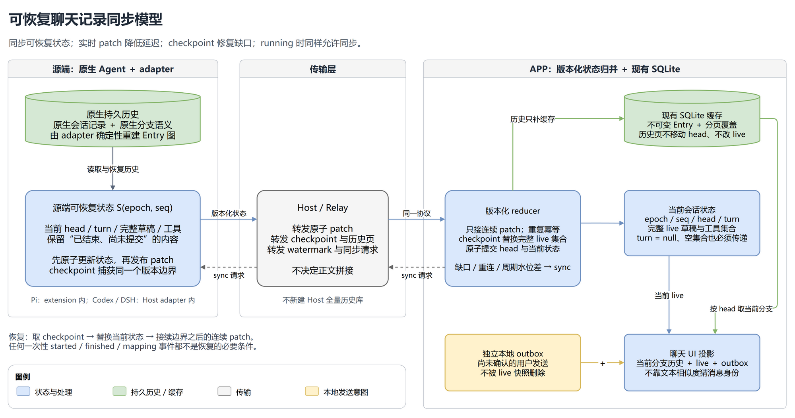

# ADR-0024：可恢复的会话状态同步

日期：2026-10-08

2026-10-27：[ADR-0045](0045-tool-summaries-and-on-demand-content.md) 将工具完整性改为标准摘要及独立库存引用的覆盖；原始参数、执行输出和结果按设备私有范围读取。聊天 checkpoint 精确依赖库存版本，详情不参与 applied；来源有序提交和 Entry/head/live 原子性继续有效。

2026-10-10：[ADR-0025](0025-native-history-authority-and-versioned-caches.md) 替代本文的不可变缓存与同 ID 硬冲突条款。版本化历史页携带 source 所有权；原生权威修正通过新 epoch 与 APP 缓存事务生效。checkpoint/patch、running sync 和恢复调度继续遵守本文。

2026-10-22：[ADR-0037](0037-session-sync-transaction-contract.md) 为本文的恢复任务补上协调侧契约：Host 作为协调者用租约判定作废，终态送达设备，提交以设备确认 applied 为准，失败只写尝试状态。

Status: accepted（Pi、Codex、DSH 与 APP 已接入源端状态复制；大 checkpoint 分块及完整设备故障矩阵仍待验收）

2026-10-22：[ADR-0037](0037-session-sync-transaction-contract.md) 定义本文准入拒绝的失败语义：`session_sync_busy` 一族是背压，客户端按背压生命周期重试。checkpoint/patch、epoch/seq、缓存事务不变。

2026-10-22：[ADR-0035](0035-incremental-session-reconcile.md) 修正本文引入的实现代价：`reconcile` 的全量比较/深拷贝、每次 `session.sync` 的强制核对、以及 live 状态的逐 token 重算。恢复契约（原生历史权威、checkpoint/patch、epoch/seq、缓存事务）不变。

2026-10-13：[ADR-0032](0032-host-owned-agent-state-model.md) 将最终架构扩展为 Host 保存完整逻辑 Agent 模型的有界当前投影，并由适配层统一历史显示数据。本文的原生历史权威、源端可恢复状态、checkpoint/patch 和缓存事务继续有效；Host 不新增全量持久聊天数据库。该模型迁移尚待实现。

关联：[ADR-0013](0013-bounded-session-sync-and-shared-tree-ingestion.md)、[ADR-0023](0023-codex-revert-and-client-refresh.md)、[ADR-0064](0064-protocol-compatibility.md)。实施跟踪：[Issue #2](https://github.com/WGooold/Orbis/issues/2)、[Issue #3](https://github.com/WGooold/Orbis/issues/3)。

## 要解决的问题

2026-10-10：[ADR-0026](0026-host-selected-session-sync.md) 实现周期轻量核对，并让源端选择 preview 的实际内容。preview 不再每次固定下载 tail，完整 checkpoint、epoch 恢复和历史页职责仍遵守本文。

允许 running 时同步，而且在事件缺失、延迟、重复、断线、换路、回退之后，手机能重新得到正确的当前聊天状态。恢复以可重建的当前状态为基线。

核心决定：**实时传输和 sync 复制同一份会话状态。实时事务用于低延迟更新，checkpoint 用于重新建立正确基线，历史页用于补齐不可变内容。**

本方案不增加 Host 全量聊天数据库。原生 Agent 保存持久历史；各 Agent backend 的源端 adapter 保存当前可恢复状态；手机沿用 SQLite Session Tree Cache。这里统一的是状态复制契约，不把 Pi tree、Codex revert、DSH fork 改造成同一种原生功能。



[可编辑图源](assets/0024-session-sync-model.drawio)

## running 同步的现有缺口

以下是设计时通过代码审查确认的处理路径；部分已由下述实施阶段修正，不表示每项均已完成真实链路复现：

| 现有处理 | 可能产生的具体问题 |
| --- | --- |
| `requestRuntimeRefresh` 在 running 或存在 streaming ID 时返回 | 漏掉结束事件留下的 overlay，会阻止用于修复它的 sync |
| sync 主要返回已提交 Entry，live 正文依靠收到的 delta 拼接 | 漏掉正文中段后，没有可读取的完整草稿来补上；只收到后缀也能被显示成普通消息 |
| preview/catchup 投影清理 active timing；`turn.finished` 先检查 timing，再处理 mapping | sync、重连、ctl 的 idle 提前到达，都可能使后到的映射被跳过 |
| remap 删除目标行；不同 ID 的实时/历史消息按正文等特征猜身份 | canonical 先到时可能被删除；残缺正文不能归并；相同短文本可能误归并 |
| 漏结束事件时保留 unfinished message/tool | sync 不携带完整 live 集合，不能证明哪些旧实时对象已经不存在 |
| 本地已覆盖 metadata leaf 时，catchup 可以直接结束 | metadata 漏收或 running 中 leaf 尚未发布时，刷新不一定真正查询源端 |
| 外层 sequence 按 runtime/channel 分配，包含其他设备的定向响应 | 本机看到数字跳号不一定丢了共享状态；发送时取号也不代表快照采集时点 |
| Codex 回放会参考旧内存顺序/parent，外部 revert 尚无完整协调流程 | 相同 Entry ID 可能被重建成不同内容；读取历史与新通知竞争，产生 conflict 或旧尾部复活 |

参考实现：[RemoteState.kt](../../android/app/src/main/java/com/orbising/orbis/RemoteState.kt)、[RemoteViewModel.kt](../../android/app/src/main/java/com/orbising/orbis/RemoteViewModel.kt)、[codex-runtime.ts](../../packages/host/src/codex-runtime.ts)、[host-service.ts](../../packages/host/src/host-service.ts)。

## 1. 一份状态，三类数据各有归属

源端统一维护版本化会话状态，分别表达持久历史、实时内容和执行状态；当前显示、历史覆盖与本地输入各自保持归属。

| 数据 | 所有者与性质 | 手机如何使用 |
| --- | --- | --- |
| canonical Entries | 从原生持久历史确定性生成；同 ID 的 parent/type/timestamp/data 不变 | 存入现有 SQLite；按当前 head 的 parent 链投影 |
| current state | 源端 adapter 持有：当前 head、当前 turn、live 消息、工具状态 | checkpoint 整体建立基线，patch 原子推进；不写成未完成 canonical Entry |
| local outbox | 手机尚未确认的发送操作，使用 command/operation 身份 | 按操作身份独立保存并结算 |

### 身份与提交

临时对象使用 (epoch, liveId)，canonical 节点使用 (sessionId, entryId)。来源在一个事务中交接历史、实时对象和执行事实，App 本地 outbox 独立对账。

```text
baseSeq = 41, seq = 42
addEntries = [稳定的 Entry E]
removeLiveIds = [临时消息 L]
currentHead = E
```

## 2. 每个 Session 只有一条状态版本序列

每个 Session 使用 source、epoch 和连续 seq 表达来源与版本；完成原生核对后建立 ready 基线，异步工作提交前校验协调代次。

```text
session identity（沿用当前 Host/Runtime/Session 路由归属）
sourceEpoch
baseSeq
seq
changes
```

## 3. checkpoint 是可独立恢复的基线

checkpoint 在来源的串行提交边界捕获可恢复状态，明确范围与完整性；部分状态保留未知标记，增量依赖有效基线与连续版本。

```text
sourceEpoch, seq
currentHead + headCompleteness
sourceReady
currentTurn（已知的 turn、明确为空，或明确未知）
liveMessages（累计正文、状态、所属 turn）
tools（完整当前集合及可恢复的 input/output/state）
live inventory completeness
固定 currentHead 的历史 tail 页或读取引用
```

### 手机的应用规则

App 校验归属、范围和版本，事务提交历史后发布对应基线；缺口进入有界缓冲和 checkpoint 恢复，当前视图保留最后有效内容。

### 一个缺失中段的例子

```text
手机已确认 v20，正文是“你好”。
v21（追加“，世界”）在断线期间丢失。
v22（追加“！”）到达，要求 baseSeq=21。
手机发现本地只有20，暂存22，发起恢复，不生成“你好！”。
源端捕获 checkpoint v24，累计正文是“你好，世界！今天”。
手机等待响应期间收到25、26，暂存。
应用v24，丢弃<=24的缓冲，再应用连续的25、26。
```

反过来，如果手机已经连续应用到 v26，旧 checkpoint v24 才到，则不让画面倒退。若 finish/commit 全部丢失，恢复直接得到最终 Entries 和新的 live 集合，无需重播那些通知。

## 4. 历史分页只补缓存，当前状态只随版本提交

历史分页补齐固定缓存范围；当前 head、实时内容和执行状态随已验证的 checkpoint / patch 提交。各响应共享持久化校验与覆盖事实。

## 5. 缺口触发恢复，周期对账兜住静默缺失

缺口和 unknown 触发来源核对，周期核对发现静默变化；恢复绑定原任务归属、范围和租约，采用有界等待与重试。

## 6. revert 状态事务

回退建立新协调边界，再核对原生历史并发布基线；原生修正通过源版本和缓存事务生效。

## 收敛保证与能力边界

在网络最终能够完成一次 checkpoint 及所需历史页传输、源端状态仍可读取、变更速率不持续超过处理能力、内容处于支持的资源上限内时：

1. checkpoint 直接把手机恢复到某个已确认的 `S(epoch,seq)`，不依赖此前事件是否齐全。
2. 每次后续事务只从匹配的 base 版本应用，保持状态连续；不匹配就回到 checkpoint。
3. 缺口检测处理显性缺失，周期对账处理最后一条事件消失以及漏掉原生通知。
4. 来源稳定后，手机最终得到同样的 active head、canonical 正文、live 集合、turn 和工具状态；未加载范围明确为缺口，不伪装成完整。

无需无限事件日志、逐包 ACK、永久 mapping 日志、正文相等匹配、全量历史 digest 或新的 Host 聊天库。有限事件回放可作为以后节省带宽的优化，不是首版正确性前提。

这里有不可由协议创造的数据：Codex 晚接入进行中的 turn 时，原生 API 可能不提供之前正文，而 adapter 从未收到它。此时只能明确不完整，并在完整 item/持久历史可读后补齐。若要求进程崩溃后也恢复原生不持久化的每个 token，额外需要源端 live checkpoint 持久化或原生恢复 API，单加手机数据库做不到。

同样，原生 revert 已删除、所有现存缓存都没有的旧分支，不能承诺以后在新设备恢复。若产品要求永久保留所有旧分支，才需要额外的历史留存职责。这与修复当前分支同步是不同要求。

## 最小实施范围与现有决定的变化

| 模块 | 职责 |
| --- | --- |
| Protocol | strict checkpoint/patch/page schema、状态版本、完整性声明、硬版本升级；沿用现有路由和加密 |
| Pi extension | 在网络发送之前累计当前消息/工具/turn；从 SessionManager 核对持久化边界；提供可重取 checkpoint |
| Codex adapter | 累计 live；确定性重建 canonical；统一外部/内部 revert 协调；晚接入未知内容显式表示 |
| DSH adapter | 复用已有累计 stream 状态，将完整 turn/tool/live 纳入 checkpoint；保留原生 fork 语义 |
| Host/Relay | Host 保留定向响应、去重背压及状态事务转发；Relay 继续转发不透明密文，不接管 Session 语义 |
| APP reducer | 单一版本化状态入口；完整恢复替代正文猜合并/一次性 mapping；outbox独立；取消 running sync 禁令 |
| APP SQLite / ingestion | 按 ADR-0025 校验权威版本与结构、事务更新缓存和 coverage；历史页面不直接控制当前 head 或运行态 |
| APP sync scheduler | checkpoint 恢复与历史补页分责；前台周期源端探测真正发请求；有界缓冲与单任务合并 |

保留 ADR-0013 的原生身份、统一写入、连续覆盖、分页预算、定向返回和背压。同 ID 与旧缓存的差异按 ADR-0025 处理。当前状态由版本化 checkpoint/patch 决定，mode 只描述历史范围；旧任务仍遵守严格归属。

实施顺序：先确定源端可恢复状态和 canonical 稳定性，再接入 checkpoint/patch 与 APP 单一 reducer，最后启用 running sync 和自动恢复。各阶段按依赖完成交接。

协议按 ADR-0064 演进，聊天状态由版本化 checkpoint / patch 的单一 reducer 管理。

## 实施进度与启用范围

- Protocol 的 checkpoint/patch 契约已接入全部后端；当前工作树协议版本为 12（条件响应见 ADR-0026，通知集合另见 ADR-0028）。状态 checkpoint 只由 preview 返回，history/catchup 携带 source 所有权，不接管当前 head/live。
- Codex adapter 和 APP reducer 为首阶段实现；2026-10-10 继续接入 Pi extension、默认 DSH Web adapter 及 legacy/test ACP adapter。APP 复用已有版本化入口；这些源端不再向手机发布旧 message/turn/tool 生命周期事件，不存在新旧事件共同写聊天状态的回落路径。
- Codex 的确定性重建、协调代次与版本化 live/checkpoint 已有实现和单测。原生通知的 canonical 提交及 live/tool 移除作为一次状态事务发布；每 15 秒、重新 announce 以及到期 preview 核对原生 `thread/turns/list`，可以发现静默回退和遗漏的完成通知。首版会读取完整 turns，长会话和多会话的读取成本仍需优化；原生多页没有 revision token 时要求连续读取一致，不把无法确认的结果发布为 ready。
- CODEX-HISTORY-01（2026-11-12）：多页一致性比较对仍在运行的末尾 turn 只核对身份，其余 turn 完整比较，页间回退照常拒绝；分页游标重复报 `codex_native_history_cursor_loop`，两类失败及 `session.sync` 失败行记录原因。实现与回归见 [codex-runtime.ts](../../packages/host/src/codex-runtime.ts)、[codex-runtime.test.ts](../../packages/host/src/codex-runtime.test.ts)、[session-sync-tasks.ts](../../packages/host/src/session-sync-tasks.ts)，现场摘录与自动验证见 [verification.json](../../.artifacts/codex-history-unstable-20261112/verification.json)。代码修复与自动验证完成；未部署，用户验收待用户验证。
- APP 已实现缺口恢复、完整 checkpoint 后重放连续 patch、history/catchup 只补缓存和旧生命周期隔离。SQLite 版本 7 按 ADR-0025 持久化缓存 epoch/行 seq 并允许权威修正；保留旧 Codex 表示迁移记录，非法结构仍整批失败。
- Codex GUI/TUI 自动刷新由 ADR-0023 / Issue #4 跟踪。刷新协调器和持久 journal 不等于生产 driver 已接入，也不等于真实 GUI 已完成 hydration。
- 单测覆盖和真实链路验收分别记录。此前 Android SQLite 设备测试 20 项通过，覆盖旧 Codex 缓存迁移、迁移失败整批回滚、不可变冲突与 coverage 恢复；本次 Pi/DSH 的源端与隔离原生链路验证见下节。大 checkpoint 分块、真实手机断连/换路及全部故障矩阵仍是明确限制。

### Pi / DSH 接入与验证（2026-10-10）

**共同机制**：`RecoverableSessionSource` 在传输之前持有累计消息、工具、turn 和版本。同步读取得到独立 checkpoint，不受之后的对象修改影响。canonical 新增与 live 副本移除在一笔 source 事务中发布；结束但未持久化的消息仍可恢复。历史祖先补页不推进当前状态版本；原生节点修正、删除或当前 head 回退时建立新 epoch，先发布 unknown，再通过 preview 恢复。只凭正式 ID / 源端映射判定提交，不按正文猜身份。

[根部测试约束](../../AGENTS.md#测试)；[Tests](../../ios/Orbis/Tests)；[orbis](../../android/app/src/test/java/com/orbising/orbis)；[src](../../packages/host/src)。

## 故障注入验收

[测试规则](../../AGENTS.md#测试)；[OrbisUITests.swift](../../ios/Orbis/UITests/OrbisUITests.swift)；[orbis](../../android/app/src/androidTest/java/com/orbising/orbis)；[原始证据](../../.artifacts/)。
